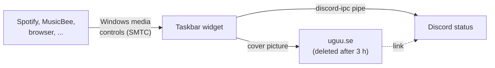

<h1 align="center">Taskbar Music Lounge</h1>

  <b>Your music on the taskbar, now with Discord status.</b> 
  A modified version of Hashah2311's <a href="https://github.com/ramensoftware/windhawk-mods/blob/main/mods/taskbar-music-lounge.wh.cpp">Taskbar Music Lounge</a> Windhawk mod. It adds Discord Rich Presence, a progress bar and per-player colors to his now-playing widget for the Windows 11 taskbar.

  <a href="#installation">Install</a> ·
  <a href="https://github.com/ds1s1s1/taskbar-music-lounge/releases/latest">Download</a> ·
  <a href="#whats-new-in-this-version">What's new</a> ·
  <a href="#settings">Settings</a> ·
  <a href="#discord-status">Discord status</a> ·
  <a href="#troubleshooting">Troubleshooting</a> ·
  <a href="#credits">Credits</a>

  
  
  
  
  

> [!NOTE]
> The widget itself is [Hashah2311](https://github.com/Hashah2311)'s work. If you only want the widget, install the original **Taskbar Music Lounge** straight from Windhawk. This repo is for people who want the extra features below.

## What's new in this version

- **Discord status**: shows the song you're listening to on your Discord profile, no extra app needed
- **Song and video pictures on Discord**: the cover of whatever is playing, YouTube thumbnails included, shows up next to your status
- **The right picture every time**: the art changes as soon as the player's does instead of sticking to the previous song, video thumbnails are cropped to a square instead of squashed, and on sites that don't provide a picture you don't get the previous video's picture instead
- **Progress bar** for the current track
- **Colors that match the player**: Spotify green, MusicBee amber, Apple Music red and so on
- **Preferred player** setting for when more than one app is playing
- **Firefox shows up by name**: Firefox and browsers built on it, like Zen, used to appear as just "Media"
- Every setting has a proper name and description in Windhawk

## Already in the version this is based on

- Album art, title and artist, with previous / play-pause / next buttons
- Works with any player that shows up in the Windows media flyout
- Scroll over the widget to change the volume
- Acrylic background that follows light/dark mode, or your own text color and opacity
- Hides in fullscreen apps and games, and when nothing has been playing for a while

## Supported players

Anything that shows up in the Windows media flyout works. These get their own accent color:

  
  
  
  
  
  
  
  
  
  
  

## Installation

1. Install [Windhawk](https://windhawk.net/).
2. Click **Create a new mod** and replace the template with the contents of [`taskbar-music-lounge.wh.cpp`](taskbar-music-lounge.wh.cpp) (it's also attached to every [release](https://github.com/ds1s1s1/taskbar-music-lounge/releases/latest)).
3. Compile it and exit the editor. Play something and the widget shows up on the taskbar.

If you also have the original Taskbar Music Lounge installed, disable it so you don't get two widgets.

## Settings

Everything is in the mod's **Settings** tab in Windhawk.

| Setting | Default | What it does |
| --- | --- | --- |
| Panel width / height | `360` / `44` | Size of the widget in pixels |
| Font size | `12` | Size of the title and artist text |
| Button scale | `1.15` | Size of the playback buttons |
| Horizontal / vertical offset | `380` / `0` | Position relative to the taskbar |
| Follow system theme | on | Text color and background follow light/dark mode |
| Manual text color | `FFFFFF` | Used when "Follow system theme" is off |
| Background opacity | `140` | Used when "Follow system theme" is off |
| Hide in games / fullscreen | on | Hides the widget while a fullscreen app is active |
| Idle hide timeout | `15` | Seconds with nothing playing before it hides, `0` to always show |
| Preferred player | | e.g. `spotify` to always show Spotify when it's playing |

> [!TIP]
> Drag the widget sideways to find a good spot, then put that offset in **Horizontal offset** so it stays there after a restart.

## Discord status

The mod can show the song you're listening to on your Discord profile. It talks to the Discord app directly, so there's nothing else to install.

1. Create an application at [discord.com/developers/applications](https://discord.com/developers/applications). Its name is what Discord shows after "Listening to", so something like **Music** works well.
2. Copy the **Application ID** from the General Information page.
3. In the mod settings, turn on **Enable Discord presence** and paste the ID into **Discord Client ID**.
4. Optional: upload an image under **Rich Presence > Art Assets** and put its name in **Discord large image key**. It's shown when there's no song picture.

The status clears when you pause, unless **Keep Discord status while paused** is on. **Discord activity label** switches between "Listening to" and "Playing".

### Song and video pictures

Discord only shows pictures from a link, but Windows gives the mod the picture itself. So with **Show the song or video picture on Discord** on (the default), the mod uploads the current cover to [uguu.se](https://uguu.se), a free host that deletes files after 3 hours, and puts that link in your status. Each picture is uploaded once and reused while it's still online, and nothing is uploaded while Discord status is off.

When the song changes, the new title and its picture show up on Discord together. Players often send the title a moment before the picture, so the mod waits a few seconds for it rather than showing the new song with the old cover.

> [!NOTE]
> Like any picture in a Discord status, the uploaded covers can be opened by anyone who has the link. If you'd rather not upload them, turn the setting off and Discord shows your **Discord large image key** instead.

## Troubleshooting

<b>MusicBee doesn't show up</b>

 
Turn on MusicBee's Windows media controls integration in its preferences. The widget only sees players that report to Windows.

<b>The wrong player is shown</b>

 
When more than one thing is playing, the widget follows whatever Windows considers the current session. Set <b>Preferred player</b> (for example <code>musicbee</code>) to always prefer one app.

<b>No Discord status</b>

 
Make sure the Discord desktop app is running, the Client ID is correct, and <b>Share your detected activities with others</b> is on under Activity Privacy in Discord's settings.

<b>Discord shows the app image instead of the song picture</b>

 
Either the player didn't provide a picture for that track, or the upload to uguu.se failed. The mod tries again a minute later, and the reason is written to the mod's log in Windhawk. If uguu.se is blocked on your network, turn off <b>Show the song or video picture on Discord</b>.

## How it works

The mod runs in its own small helper process next to `explorer.exe`. It reads the current media session from SMTC, draws the widget with GDI+ in a window that sits on the taskbar, and if Discord status is on, sends the song to the Discord app over its local IPC pipe, along with a link to the uploaded cover.

## Credits

- [Hashah2311](https://github.com/Hashah2311) made the original [Taskbar Music Lounge](https://github.com/ramensoftware/windhawk-mods/blob/main/mods/taskbar-music-lounge.wh.cpp), which this is based on.
- Discord status with cover pictures, the progress bar, per-player colors and the preferred player setting were added by [ds1s1s1](https://github.com/ds1s1s1).

## License

The original Taskbar Music Lounge code belongs to Hashah2311 and doesn't come with an open-source license. The changes made in this repo are MIT licensed. See [LICENSE](LICENSE) for details.
