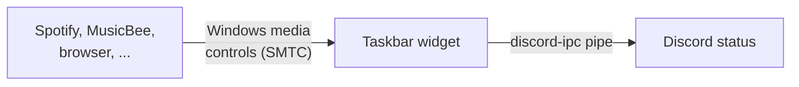

<h1 align="center">Taskbar Music Lounge</h1>

  <b>Your music, right on the taskbar.</b> 
  A Windhawk mod that adds a now-playing widget to the Windows 11 taskbar, with album art, playback controls, a progress bar and your current song on Discord. Works with Spotify, MusicBee, YouTube and anything else that uses the Windows media controls.

  <a href="#installation">Install</a> ·
  <a href="https://github.com/ds1s1s1/taskbar-music-lounge/releases/latest">Download</a> ·
  <a href="#features">Features</a> ·
  <a href="#settings">Settings</a> ·
  <a href="#discord-status">Discord status</a> ·
  <a href="#troubleshooting">Troubleshooting</a> ·
  <a href="#how-it-works">How it works</a>

  
  
  
  
  

## Features

- **Now playing on the taskbar**: album art, title and artist, with previous / play-pause / next buttons
- **Progress bar** for the current track, and long titles scroll instead of getting cut off
- **Colors that match the player**: Spotify green, MusicBee amber, Apple Music red and so on
- **Volume on scroll**: scroll over the widget to turn the volume up or down
- **Fits in**: acrylic background that follows light/dark mode, or your own text color and opacity
- **Stays out of the way**: hides in fullscreen apps and games, and when nothing has been playing for a while
- **Discord status**: shows the song you're listening to on your profile, no extra app needed

## Supported players

Anything that shows up in the Windows media flyout works. These get their own accent color:

  
  
  
  
  
  
  
  
  
  
  

## Installation

1. Install [Windhawk](https://windhawk.net/).
2. Click **Create a new mod** and replace the template with the contents of [`taskbar-music-lounge.wh.cpp`](taskbar-music-lounge.wh.cpp) (it's also attached to every [release](https://github.com/ds1s1s1/taskbar-music-lounge/releases/latest)).
3. Compile it and exit the editor. Play something and the widget shows up on the taskbar.

## Settings

Everything is in the mod's **Settings** tab in Windhawk.

| Setting | Default | What it does |
| --- | --- | --- |
| Panel width / height | `360` / `44` | Size of the widget in pixels |
| Font size | `12` | Size of the title and artist text |
| Button scale | `1.15` | Size of the playback buttons |
| Horizontal / vertical offset | `380` / `0` | Position relative to the taskbar |
| Follow system theme | on | Text color and background follow light/dark mode |
| Manual text color | `FFFFFF` | Used when "Follow system theme" is off |
| Background opacity | `140` | Used when "Follow system theme" is off |
| Hide in games / fullscreen | on | Hides the widget while a fullscreen app is active |
| Idle hide timeout | `15` | Seconds with nothing playing before it hides, `0` to always show |
| Preferred player | | e.g. `spotify` to always show Spotify when it's playing |

> [!TIP]
> Drag the widget sideways to find a good spot, then put that offset in **Horizontal offset** so it stays there after a restart.

## Discord status

The mod can show the song you're listening to on your Discord profile. It talks to the Discord app directly, so there's nothing else to install.

1. Create an application at [discord.com/developers/applications](https://discord.com/developers/applications). Its name is what Discord shows after "Listening to", so something like **Music** works well.
2. Copy the **Application ID** from the General Information page.
3. In the mod settings, turn on **Enable Discord presence** and paste the ID into **Discord Client ID**.
4. Optional: upload an image under **Rich Presence > Art Assets** and put its name in **Discord large image key**.

The status clears when you pause, unless **Keep Discord status while paused** is on. **Discord activity label** switches between "Listening to" and "Playing".

> [!NOTE]
> Album art isn't sent to Discord. Windows only gives the mod the image itself, and Discord needs a URL.

## Troubleshooting

<b>MusicBee doesn't show up</b>

 
Turn on MusicBee's Windows media controls integration in its preferences. The widget only sees players that report to Windows.

<b>The wrong player is shown</b>

 
When more than one thing is playing, the widget follows whatever Windows considers the current session. Set <b>Preferred player</b> (for example <code>musicbee</code>) to always prefer one app.

<b>No Discord status</b>

 
Make sure the Discord desktop app is running, the Client ID is correct, and <b>Share your detected activities with others</b> is on under Activity Privacy in Discord's settings.

## How it works

The mod runs in its own small helper process next to `explorer.exe`. It reads the current media session from SMTC, draws the widget with GDI+ in a window that sits on the taskbar, and if Discord status is on, sends the song to the Discord app over its local IPC pipe.

## License

[MIT](LICENSE)
